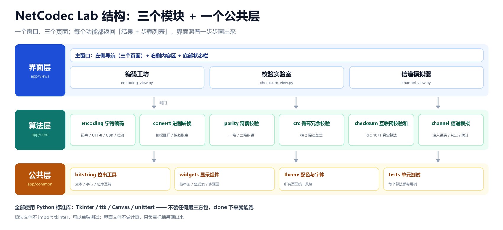
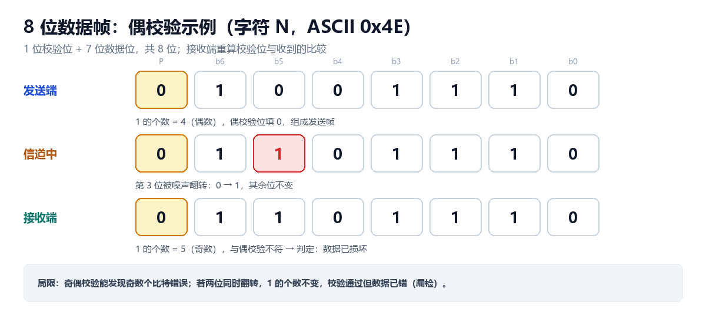
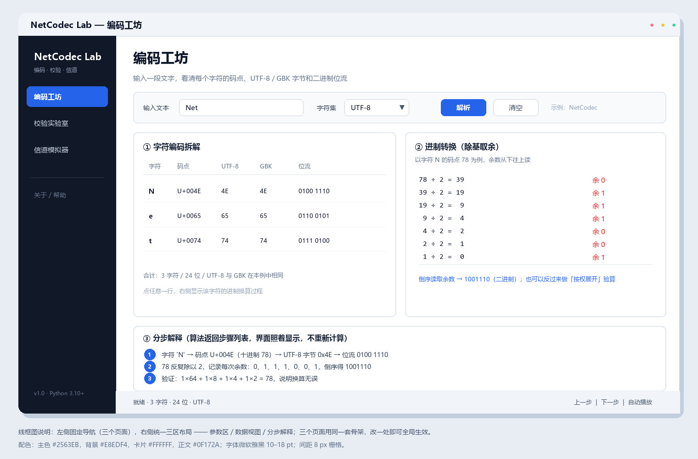

# NetCodec Lab —— 编码与校验可视化

**项目文档**：需求与设计
**版本**：v1.2（选题审核修订稿）
**课程**：计算机科学基础 · 综合实验
**小组**：高郑豪（组长）、周恩旭、张鑫渝、郑婉欣

---

## 1. 项目背景

在计算机网络通信中，数据必须先编码成二进制才能传输；而在传输过程中，信号又极易受到干扰，发生**比特翻转**。

这条链路在课本上被拆成三个互不相连的章节：字符编码、校验位、差错控制。本项目的想法很简单——**把它们连成一条可以点、可以看的流水线**：一段文字怎么变成 0/1、怎么加上校验位、被改坏之后又是怎么被发现的。

## 2. 项目目标

用 Python + Tkinter 做一个单窗口演示程序，包含三个可切换的页面：

- **编码工坊**：输入任意文本，逐字符显示 `码点`、`UTF-8 / GBK 字节` 与 `二进制位流`，并把进制互转的**每一步竖式**画出来；
- **校验实验室**：奇偶校验、二维奇偶校验、CRC、Internet 校验和、汉明码，逐步展示**校验位计算、组帧、接收端判定**；
- **信道模拟器**：组帧后点击任意一位注入错误，接收端给出判定，并**横向对比五种方案**能不能发现这个错误。

**验收口号**：三个模块全部可运行，五个校验算法的标准值全部对得上。

## 3. 技术栈与工具

| 项目 | 选择 | 理由 |
| :--- | :--- | :--- |
| 编程语言 | **Python 3.10+** | 标准库自带 `unittest`、`binascii`，算法实现短 |
| 界面库 | **Tkinter** | 随官方安装包自带，队友 clone 下来就能跑，不用配环境 |
| 版本控制 | **Git + GitHub** | 分支、PR、Code Review 是评分项 |
| 开发环境 | VS Code + Git Graph 插件 | 看历史、解冲突直观 |
| 编程范式 | **Vibe Coding** | 提示词驱动 AI 生成，人工审查与验证 |
| 第三方依赖 | **零** | 评分要求“干净电脑能跑起来” |

## 4. 系统结构



程序自上而下分三层，**依赖只能向下**：

1. **界面层 `app/views`**：只负责“摆控件 + 调函数 + 显示 steps”，**不允许重写任何算法**；
2. **算法层 `app/core`**：五种校验算法的纯函数，不 `import tkinter`，可以脱离界面单独测试；
3. **公共层 `app/common`**：位串工具（文本 ↔ 字节 ↔ 0/1）、全局常量（8 位字节、输入上限）。

这样分的好处：算法同学在命令行就能验收 `0x29B1` 这类标准值，不必等界面做完；界面同学改配色也不会碰坏算法。

## 5. 核心原理

### 5.1 字符编码与进制

ASCII 每字符 7 位有效位；**UTF-8 与 GBK 是变长编码**，同一个汉字在 UTF-8 里占 3 字节、在 GBK 里占 2 字节，所以必须**逐字符编码**，不能整串编码后再按字节切。

进制转换用两种课本算法：

- **按权展开**（任意进制 → 十进制）：每一位乘 `base^位权` 再求和；
- **除基取余**（十进制 → 任意进制）：反复除以基数记余数，**余数从下往上读**。

### 5.2 五种校验方案

| 方案 | 原理 | 能做什么 | 本项目的实现要点 |
| :--- | :--- | :--- | :--- |
| 奇偶校验 | 补 1 位，使 1 的个数为奇数或偶数 | 发现**奇数个**比特错误 | `parity.py::parity_encode / parity_check` |
| 二维奇偶 | 数据排成方阵，行、列各加 1 位 | 定位并纠正 **1 位**错误 | `matrix.py`，行列交叉点定位 |
| CRC | 模 2 除法取余数附在帧尾 | 检错能力强，可配置多项式 | `crc.py`，**逐位竖式**、不用查表、不做位反射 |
| Internet 校验和 | 16 位反码求和后取反（RFC 1071） | IP / TCP / UDP 首部实际使用 | `checksum.py`，进位加回低位 |
| 汉明码 | 校验位放 2 的幂位置，接收端用**伴随式**定位出错位 | 定位并纠正 **1 位**错误 | `hamming.py`，(7,4)，数据位在第 3、5、6、7 位 |

### 5.3 接收端判定

发送端算出校验位、与数据组成帧；接收端**重新计算**并与收到的校验位比对，不一致即判定数据损坏。

> **必须讲清楚的缺陷**：奇偶校验**只能发现奇数个错误**。若两位同时翻转，1 的个数不变，校验会通过但数据已错——这就是“漏检”。信道模拟器会把这个现象现场演示出来，并与 CRC 的表现做对比。



## 6. 界面设计



统一骨架：**左侧导航（三个页面）+ 右侧内容区 + 底部状态栏**，窗口 **1280×800**。

每个页面固定四段：

1. **参数区**：输入框 + 下拉框 + 操作按钮；
2. **数据视图**：表格或位串条，把结果画出来；
3. **分步解释**：算法返回的 `steps` 一行行显示，界面不重算；
4. **状态栏**：一句话结论（“检出错误”“校验通过”）。

配色固定为：主色 `#2563EB`、背景 `#E8EDF4`、错误 `#DC2626`、通过 `#16A34A`，字体微软雅黑 9–20 pt。

## 7. 接口约定

算法层的所有函数返回同一结构，界面层不需要写 `try/except`：

```python
{
    "ok":      True,                    # 是否成功
    "result":  ...,                     # 结果（帧、余数、方阵……）
    "steps":   [{"title": "...",        # 这一步在算什么
                 "detail": "..."}],     # 具体过程
    "message": "人类可读的一句话",
}
```

这条约定是**分工的地基**：高郑豪、周恩旭交付函数，张鑫渝只负责把 `steps` 画成表格和位串条。

## 8. 团队分工

| 姓名 | 角色 | 负责内容 | 交付物 |
| :--- | :--- | :--- | :--- |
| **高郑豪** | 组长 / 核心开发 | 校验算法（奇偶、二维奇偶、CRC、Internet 校验和、汉明码）、单元测试、Git 仓库管理与代码审查 | `app/core/*.py`、`tests/`、`tools/verify_core.py` |
| 周恩旭 | 编码与信道算法 | 字符编码拆解、进制转换、信道注入错误与方案对比、批量统计 | `encoding.py`、`convert.py`、`channel.py` |
| 张鑫渝 | UI 开发 | 主窗口、主题与公共控件、三个页面布局与联调 | `app/views/`、`app/common/theme.py` |
| 郑婉欣 | 文档与测试 | README、设计文档、截图、`AI_Prompts_Log.md`、按清单逐条点验 | `docs/`、`images/` |

**依赖关系**：高郑豪、周恩旭先出函数，张鑫渝才有东西可接；郑婉欣等三个页面能开才能截图写文档。因此**高郑豪、周恩旭不能拖**。

## 9. 验收标准

| 编号 | 操作 | 期望 |
| :--- | :--- | :--- |
| T-01 | 输入 `Net` | 24 位位流 |
| T-02 | 输入 `中文` | GBK 4 字节、UTF-8 6 字节 |
| T-03 | `78` 转二进制 | 竖式七行，结果 `1001110` |
| T-04 | 奇校验 `1011001` | 补 1，总数为 5 |
| T-05 | 二维奇偶翻 1 位 | 定位并纠正 |
| T-06 | CRC 算 `123456789` | `0x29B1` |
| T-07 | Internet 校验和 | 接收端求和为 `0xFFFF` |
| T-08 | 汉明码翻 1 位 | 伴随式指出出错位并纠正 |
| T-09 | 信道点第 3 位 | 该位变红，判定“检出” |
| T-10 | 批量实验同 seed 跑两次 | 结果完全一致 |
| T-11 | 空输入、超长输入 | 有提示，程序不退出 |

其中 **T-04 ~ T-08 属于高郑豪的交付范围**，已由 `tools/verify_core.py` 自动跑通。

## 10. 分支规划

| 分支 | 负责人 | 内容 |
| :--- | :--- | :--- |
| `main` | — | 受保护，只接受 PR 合入 |
| `feature/core-parity` | 高郑豪 | 奇偶校验 |
| `feature/core-matrix` | 高郑豪 | 二维奇偶校验 |
| `feature/core-crc` | 高郑豪 | CRC 模 2 除法 |
| `feature/core-inet` | 高郑豪 | Internet 校验和 |
| `feature/core-hamming` | 高郑豪 | 汉明码 |
| `feature/encoding` | 周恩旭 | 字符编码与进制转换 |
| `feature/ui` | 张鑫渝 | 界面三个页面 |
| `feature/docs` | 郑婉欣 | 文档、截图、测试记录 |

## 11. 选题审核与修订记录

本项目在选题审核阶段收到三条修改意见，逐条落实如下：

| 序号 | 教师/自审意见 | 修订情况 |
| :--- | :--- | :--- |
| R-1 | 原选题只做“ASCII 码 + 奇偶校验”，**技术深度不足**，工作量偏小 | 扩展为**五种校验方案**，并新增 CRC 模 2 除法竖式、汉明码伴随式定位两个有难度的算法 |
| R-2 | 三个模块彼此割裂，**看不出“一条链路”** | 统一抽象为「数据位流 → 组帧 → 注入错误 → 判定」，信道模拟器直接复用另外两个模块的帧结构 |
| R-3 | 界面容易变成“算法算完只显示一个结果”，**看不到过程** | 强制接口返回 `steps`，界面只负责**照着画**；CRC 逐字节显示中间余数，汉明码显示每一步的校验方程 |

> 修订后版本号由 v1.0 升为 **v1.2**，补充了第 4 节系统结构、第 7 节接口约定与第 9 节验收标准。

## 12. 开源协议

本项目采用 **MIT License**，详见 [LICENSE](LICENSE)。
