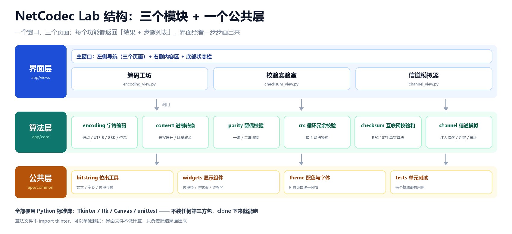

# NetCodec Lab —— 编码与校验可视化

> 计算机网络综合实验 · 计算机科学基础概念可视化
> 把「字符 → 位流 → 加校验位 → 传输出错 → 被谁发现」这条链路一步步画出来。

[](#运行环境)
[](LICENSE)
[](tests/)
[](#运行环境)

---

## 1. 这个项目在做什么

数据要在网络里传输，就得先变成二进制；传的过程中又随时可能被干扰、翻掉几位。本项目用可视化把这条链路拆开给学生看：

| 模块 | 一句话 | 负责人 | 状态 |
| :--- | :--- | :--- | :--- |
| **编码工坊** | 输入任意文本，逐字符显示码点、UTF-8 / GBK 字节与位流，并把进制互转的竖式画出来 | 周恩旭 | 未开始 |
| **校验实验室** | 五种校验方案的校验位计算、组帧、接收端判定 | 高郑豪 | **算法已完成** |
| **信道模拟器** | 组帧后点击任意一位注入错误，接收端判定，并对比五种方案的检出能力 | 周恩旭 | 未开始 |
| **界面层** | 1280×800 主窗口 + 左侧导航 + 三个页面 | 张鑫渝 | 未开始 |

> **当前进度**：组长高郑豪负责的五个校验算法与单元测试已完成并通过验收（见 [`tools/verify_core.py`](tools/verify_core.py)）。
> 界面层与文档截图由张鑫渝、郑婉欣在后续分支上补充，合入 `main` 后即可演示。



---

## 2. 运行环境

| 项目 | 要求 |
| :--- | :--- |
| Python | **3.10 及以上**（开发使用 3.12） |
| 第三方库 | **0 个**，全部使用标准库（算法层不依赖任何库，界面层只用 `tkinter`） |
| 操作系统 | Windows / macOS / Linux 均可 |

确认版本：

```bash
python --version
```

不需要 `pip install` 任何东西。如果 `tkinter` 缺失（多见于 Linux），安装系统包 `python3-tk` 即可。

---

## 3. 怎么跑

### 3.1 获取代码

```bash
git clone https://github.com/North-latitude/NetCodecLab.git
cd NetCodecLab
```

### 3.2 跑算法验收（现在就能跑）

这是组长交给界面同学的「交接证据」，逐条打印 3.1 ~ 3.5 的验收结果：

```bash
python tools/verify_core.py
```

预期输出末尾：

```text
共 13 项验收，通过 13 项，失败 0 项
五个校验函数全部符合验收标准，可以交接给界面负责人张鑫渝。
```

其中包含两个关键数字：

- `3.3 CRC：123456789` 用多项式 `0x1021`、初值 `0xFFFF` → 余数 **`0x29B1`**
- `3.5 汉明码`：翻转 7 个位置中任意一位 → 伴随式（s4s2s1）的十进制值就是出错位号，取反即纠正

### 3.3 跑单元测试

```bash
python -m unittest discover -s tests -v
```

预期结果：

```text
Ran 76 tests in 0.0XXs
OK
```

### 3.4 启动图形界面（等张鑫渝的界面合入后）

```bash
python main.py
```

> `main.py` 与 `app/views/` 由界面负责人张鑫渝在 `feature/ui` 分支上实现，尚未合入 `main`。

---

## 4. 目录结构

```text
NetCodecLab/
├── app/
│   ├── common/            # 公共层：位串工具、全局常量（不依赖 Tkinter）
│   │   ├── bits.py        #   文本 / 字节 / 位串互转、位翻转、补零对齐
│   │   └── config.py      #   8 位字节、默认字符集、输入上限等常量
│   └── core/              # 算法层：五种校验算法（纯函数，可单独测试）
│       ├── parity.py      #   奇偶校验（一维）
│       ├── matrix.py      #   二维奇偶校验（行列定位纠错）
│       ├── crc.py         #   CRC 模 2 除法（逐位竖式，不用查表）
│       ├── checksum.py    #   Internet 校验和（RFC 1071）
│       └── hamming.py     #   汉明码 (7,4) 编解码
├── tests/                 # 单元测试（76 个用例）
├── tools/
│   └── verify_core.py     # 命令行验收脚本
├── docs/
│   └── git-conflict.md    # 合并冲突演练记录
├── images/                # 文档配图（架构图、帧结构、界面设计稿）
├── Project_Requirements_and_Design.md
├── AI_Prompts_Log.md
├── LICENSE                # MIT
└── README.md
```

**分层原则**：算法层不 `import tkinter`，界面层不重写算法。界面只调用 `app.core` 暴露的函数，把返回的 `steps` 照着画出来。

---

## 5. 接口说明（交给界面的五个函数）

约定：**所有函数都返回同一个结构的字典**，界面不用写 `try/except`。

```python
{
    "ok":      True,                 # 是否成功；False 时看 message
    "result":  ...,                  # 具体结果（各函数不同）
    "steps":   [{"title": "...",     # 这一步在算什么（一行标题）
                 "detail": "..."}],  # 具体过程（一行说明）
    "message": "人类可读的一句话结论",
}
```

| 函数 | 输入 | 关键返回 |
| :--- | :--- | :--- |
| `parity_encode(bits, mode)` | 数据位串、`'even'`/`'odd'` | `result['frame']` 整帧 |
| `parity_check(frame, mode)` | 收到的帧 | `detected` 是否发现错误 |
| `matrix_encode(data, rows, cols)` | 数据、行列数 | `result['matrix']` 二维方阵 |
| `matrix_check(matrix)` | 收到的方阵 | `error_pos` 行列坐标、`corrected` 纠正后的方阵 |
| `crc_encode(bits, poly, width, init)` | 数据与多项式参数 | `result['crc_hex']`、`result['frame']`、逐步中间余数 |
| `crc_check(frame, ...)` | 收到的帧 | `detected`、`result['remainder_hex']` |
| `inet_checksum(data: bytes)` | 字节串 | `result['checksum_hex']`、每一步累加值 |
| `inet_verify(frame: bytes)` | 带校验和的帧 | `detected`、`result['sum_hex']`（应为 `0xFFFF`） |
| `hamming_encode(bits)` | 数据位串 | `result['frame']` 7 位一组的码字 |
| `hamming_decode(bits)` | 收到的码字 | `syndrome`、`error_pos`、`corrected_frame` |

示例：

```python
from app.core import crc_encode, hamming_decode

frame = crc_encode("00110001", poly=0x1021, width=16, init=0xFFFF)
print(frame["result"]["crc_hex"])      # 0x...
for step in frame["steps"]:            # 界面直接灌进“步骤表”
    print(step["title"], step["detail"])
```

---

## 6. 团队分工

| 姓名 | 角色 | 负责内容 | 分支 |
| :--- | :--- | :--- | :--- |
| **高郑豪** | 组长 / 核心开发 | 五种校验算法、单元测试、仓库管理与代码审查、冲突演练 | `feature/core-*` |
| 周恩旭 | 编码与信道 | 字符编码拆解、进制转换、信道注入错误与方案对比 | `feature/encoding` |
| 张鑫渝 | UI 开发 | Tkinter 主窗口、主题与公共控件、三个页面 | `feature/ui` |
| 郑婉欣 | 文档与测试 | README、设计文档、截图、`AI_Prompts_Log.md`、功能测试清单 | `feature/docs` |

完整分工与验收标准见组内分工文档（内部资料，不随仓库发布）。

---

## 7. 协作流程

```text
main（受保护，只能通过 PR 合入）
 ├── feature/core-parity    高郑豪  奇偶校验
 ├── feature/core-matrix    高郑豪  二维奇偶校验
 ├── feature/core-crc       高郑豪  CRC
 ├── feature/core-inet      高郑豪  Internet 校验和
 ├── feature/core-hamming   高郑豪  汉明码
 ├── feature/encoding       周恩旭  字符编码与进制转换
 ├── feature/ui             张鑫渝  界面
 └── feature/docs           郑婉欣  文档与截图
```

1. 从 `main` 切出 `feature/*` 分支；
2. 本地开发并自测（`python -m unittest discover -s tests`）；
3. `git push` 后在 GitHub 发起 Pull Request，写清改了什么、怎么验的；
4. 组长做 Code Review，**不通过就打回**，通过后合并并删除分支；
5. 冲突处理记录见 [`docs/git-conflict.md`](docs/git-conflict.md)。

提交信息规范：`feat(core): 奇偶校验`、`fix(core): CRC 初值处理`、`docs: 补充验收记录`。

### 7.1 已完成的 Pull Request

| PR | 分支 | 内容 | 结果 |
| :--- | :--- | :--- | :--- |
| #1 | `feature/core-parity` | 奇偶校验 | 已合并 ✅ |
| #2 | `feature/core-crc` | CRC 模 2 除法 | 已合并 ✅ |
| #3 | `feature/core-inet` | Internet 校验和 | 已合并 ✅ |
| #4 | `feature/core-hamming` | 汉明码编解码 | 已合并 ✅ |
| #5 | `feature/core-api` | 统一算法层出口 + 命令行验收脚本 | 已合并 ✅ |
| #6 | `feature/core-matrix` | 二维奇偶校验 | 已合并 ✅ |
| #7 | `feature/conflict-a` | 默认字符集改为 UTF-8 | 已合并 ✅ |
| #8 | `feature/conflict-b` | 默认字符集改为 GBK（与 #7 同一行，**产生冲突**） | 冲突已解决后合并 ✅ |

每个 PR 都写了「做了什么 / 怎么验的」，合并后删除对应分支，`main` 保持受保护状态。

---


## 8. 开源协议

本项目使用 [MIT License](LICENSE) 开源。

---

## 9. 参考资料

- Andrew S. Tanenbaum, *Computer Networks*（第 5 版）第 3 章 数据链路层
- J. Postel, **RFC 1071** — *Computing the Internet Checksum*
- 课程讲义《计算机科学基础》第 2 章 数据表示与编码
