# 功能测试记录

> 按验收清单逐条点验，**每条都留了截图**。截图均为程序真实运行界面，
> 窗口 1360×880，用系统截图工具直接抓取。

| 项目 | 说明 |
| :--- | :--- |
| 测试时间 | 2026-11-17 |
| 运行环境 | Windows 11 · Python 3.13 · 仅标准库（无第三方依赖） |
| 启动方式 | 仓库根目录执行 `python main.py` |
| 自动化复核 | `python tools/self_check.py`（32 项，全部通过） |

---

## 一、验收清单

| 编号 | 操作 | 期望结果 | 实际 | 截图 |
| :--- | :--- | :--- | :--- | :--- |
| T-01 | 输入 `Net` | 24 位位流 | 3 个字符 × 8 位 = 24 位 | [查看](../images/T-1.png) |
| T-02 | 输入 `中文` | GBK 4 字节、UTF-8 6 字节 | GBK 4 字节 / UTF-8 6 字节 | [查看](../images/T-2.png) |
| T-03 | `78` 转二进制 | 竖式七行，结果 `1001110` | 7 行，结果 `1001110` | [查看](../images/T-3.png) |
| T-04 | 奇校验 `1011001` | 补 1，整帧 5 个 1 | 补 1，5 个 1 | [查看](../images/T-4.png) |
| T-05 | 二维奇偶翻 1 位 | 定位并纠正 | 定位到行列交叉点并纠正 | [查看](../images/T-5.png) |
| T-06 | CRC 算 `123456789` | `0x29B1` | `0x29B1` | [查看](../images/T-6.png) |
| T-07 | Internet 校验和 | 接收端求和 `0xFFFF` | `0xFFFF` | [查看](../images/T-7.png) |
| T-08 | 汉明码翻 1 位 | 伴随式指出出错位并纠正 | 伴随式 = 011，定位第 3 位并纠正 | [查看](../images/T-8.png) |
| T-09 | 信道点第 3 位 | 该位变红，判定“检出” | 变红，判定检出 | [查看](../images/T-9.png) |
| T-10 | 批量实验同 seed 跑两次 | 结果完全一致 | 两次统计完全一致 | [查看](../images/T-10.png) |
| T-11 | 空输入、超长输入 | 有提示，程序不退出 | 均有提示，程序正常运行 | [空输入](../images/T-11-1.png) · [超长](../images/T-11-2.png) |

**结论：11 条全部通过。**

---

## 二、截图

### T-01　输入 `Net` → 24 位位流

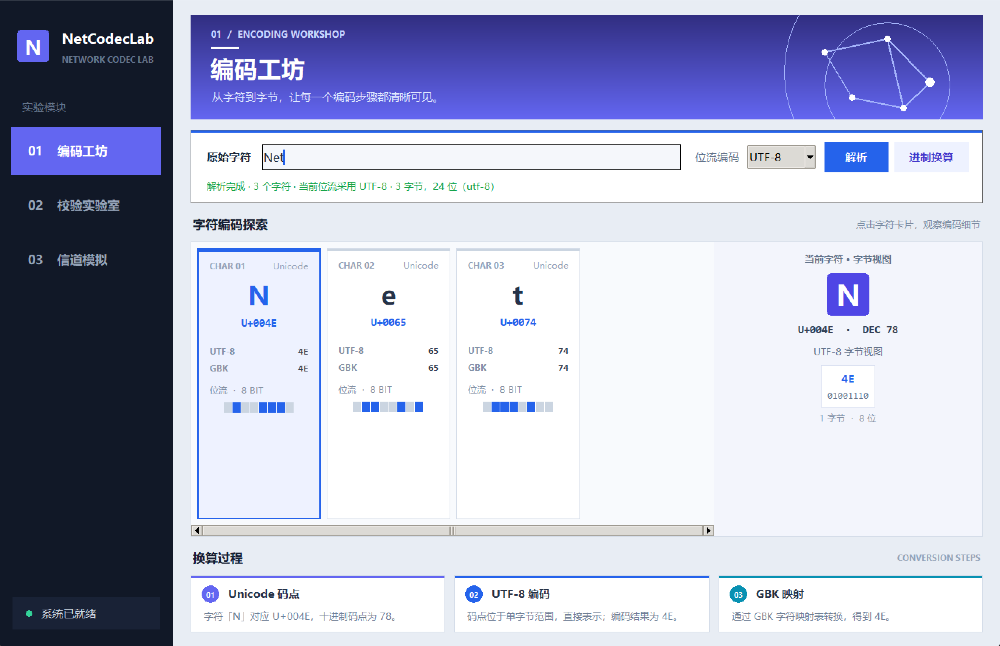

### T-02　输入 `中文` → GBK 4 字节、UTF-8 6 字节

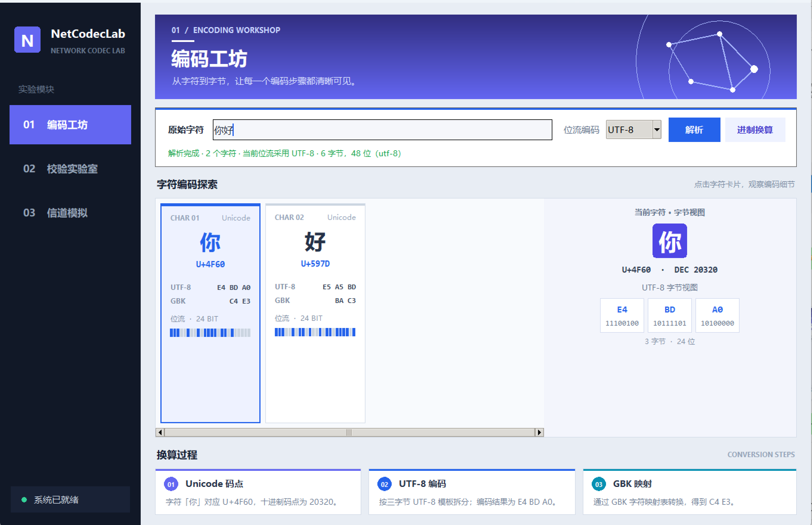

### T-03　`78` 转二进制 → 竖式七行，结果 `1001110`

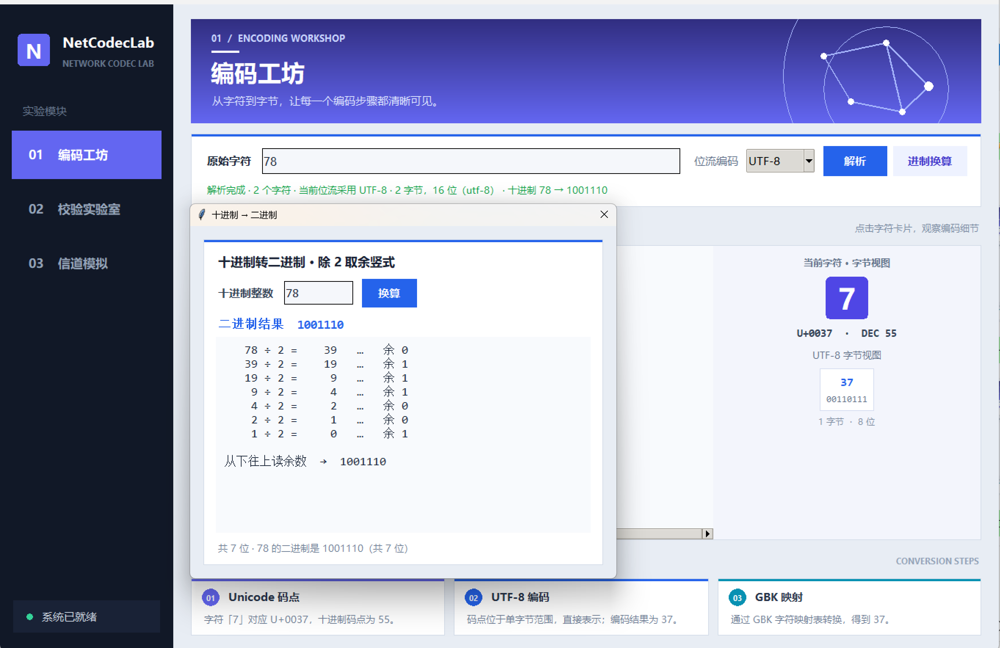

### T-04　奇校验 `1011001` → 补 1，整帧 5 个 1

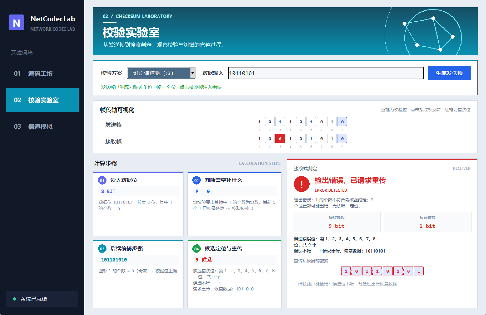

### T-05　二维奇偶翻 1 位 → 定位并纠正

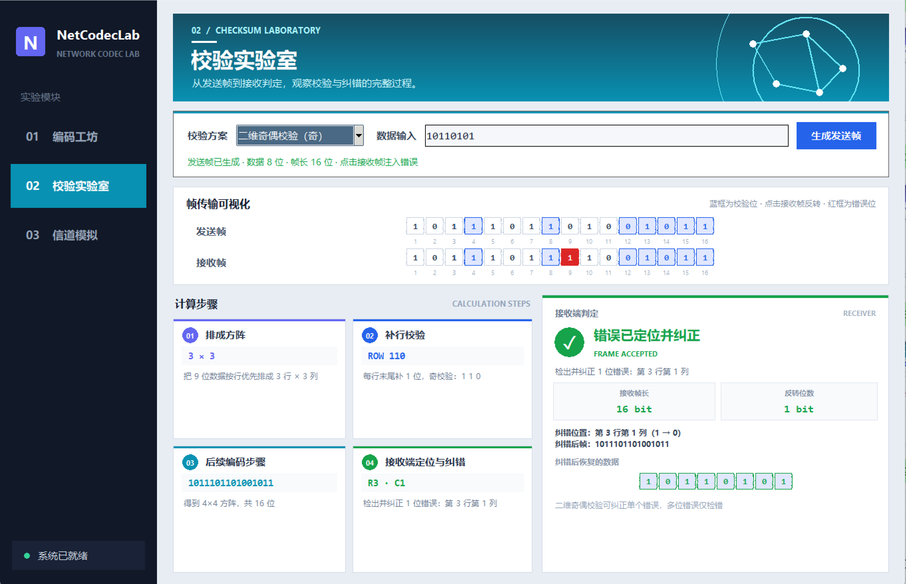

### T-06　CRC 算 `123456789` → `0x29B1`

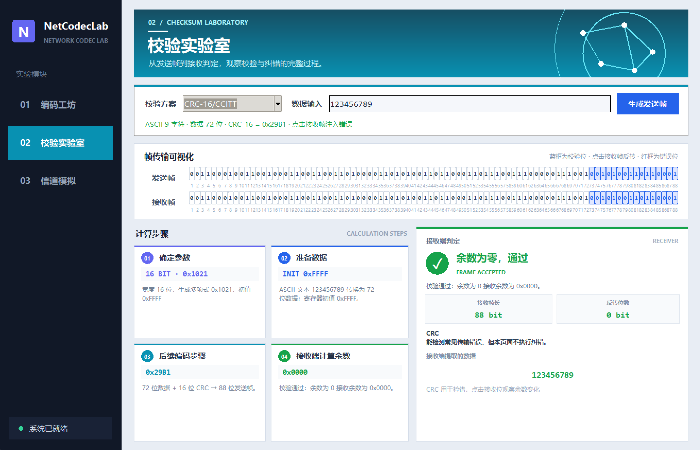

### T-07　Internet 校验和 → 接收端求和 `0xFFFF`

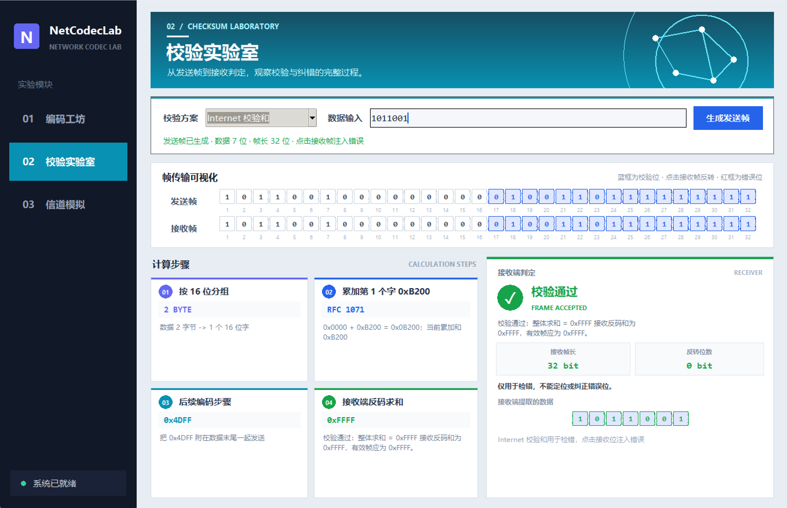

### T-08　汉明码翻 1 位 → 伴随式指出出错位并纠正

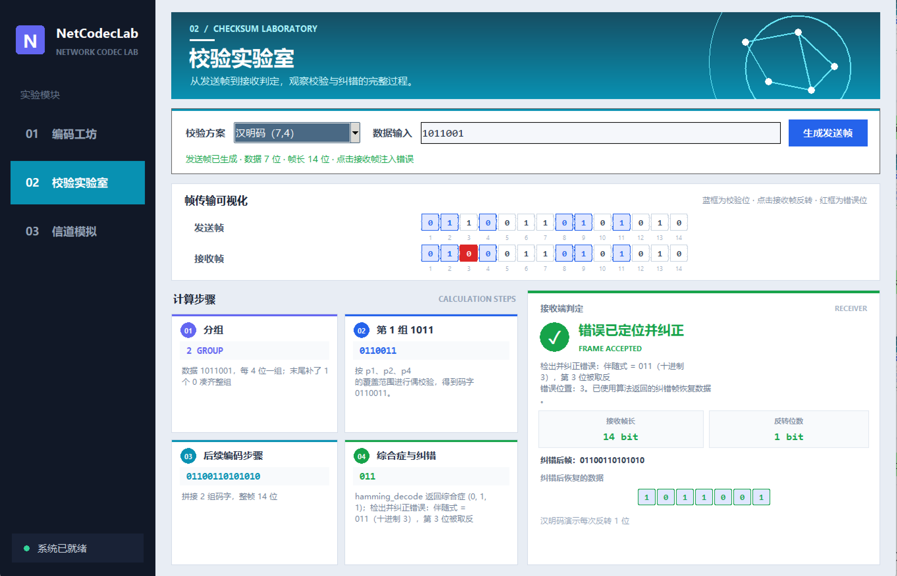

### T-09　信道模拟器点第 3 位 → 变红并判定“检出”

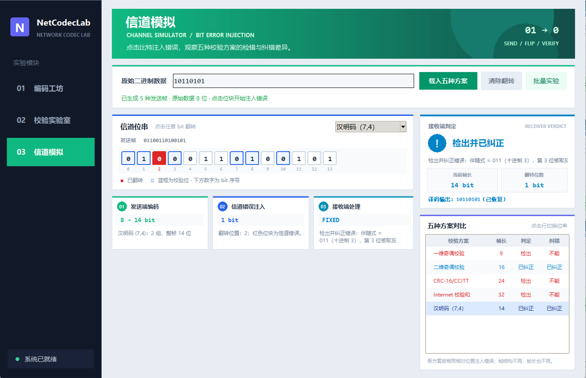

### T-10　批量实验同 seed 跑两次 → 结果完全一致

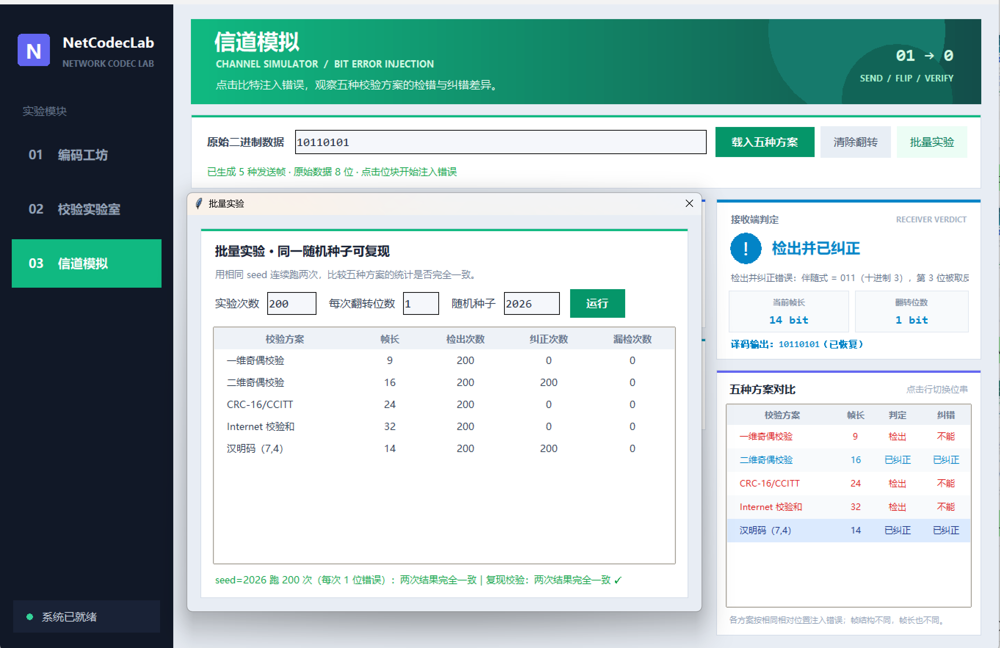

### T-11　空输入 / 超长输入 → 有提示，程序不退出

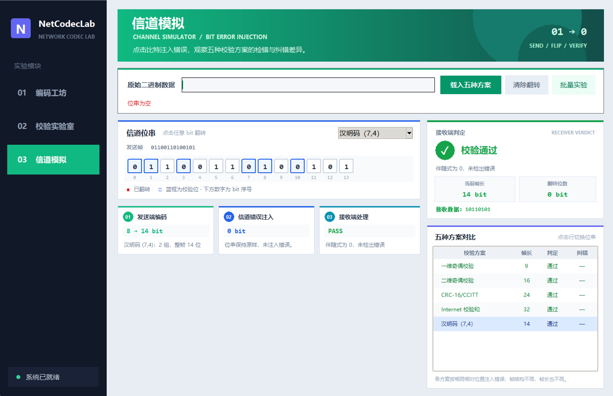

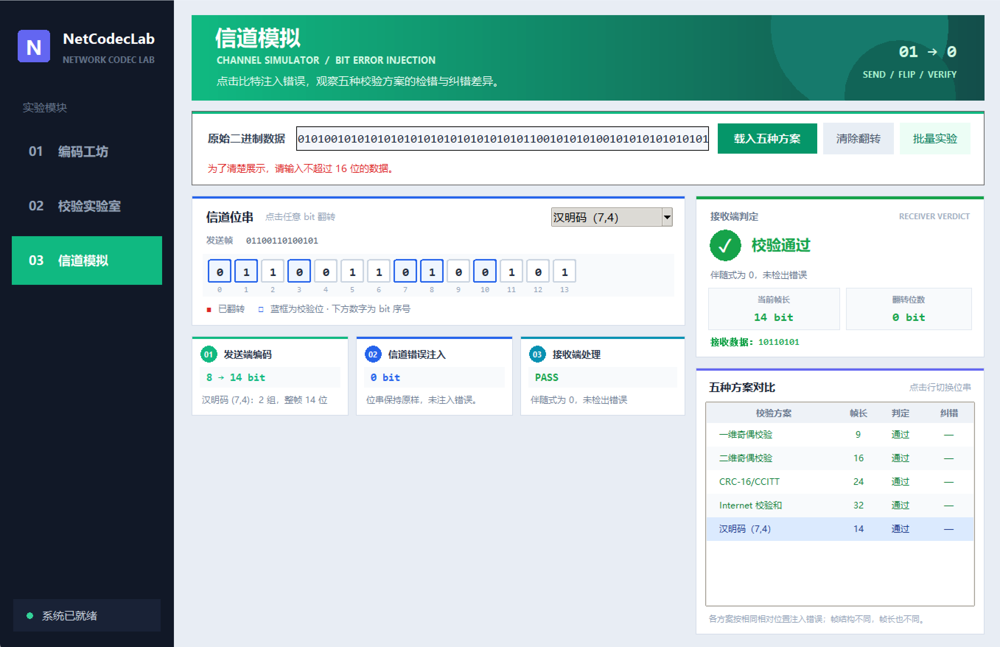

---

## 三、补充说明

1. 以上截图都是在**合并完成的 `main` 分支**上运行程序截取的，不是设计稿；
2. 除了手动点验，`python tools/self_check.py` 会自动把 T-01 ~ T-11 再跑一遍
   （算法层 19 项 + 界面层 13 项），用于防止后续改动把已通过的功能改坏；
3. 单元测试 `python -m unittest discover -s tests` 共 113 个用例，全部通过。
